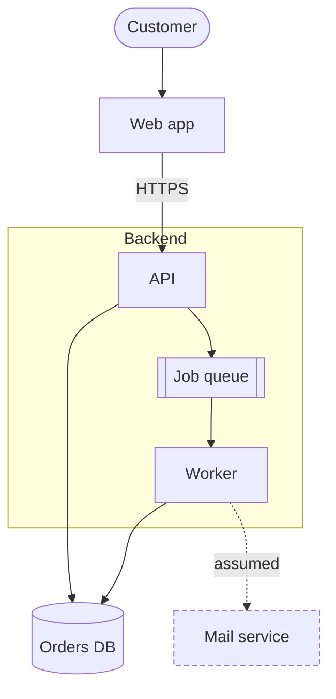
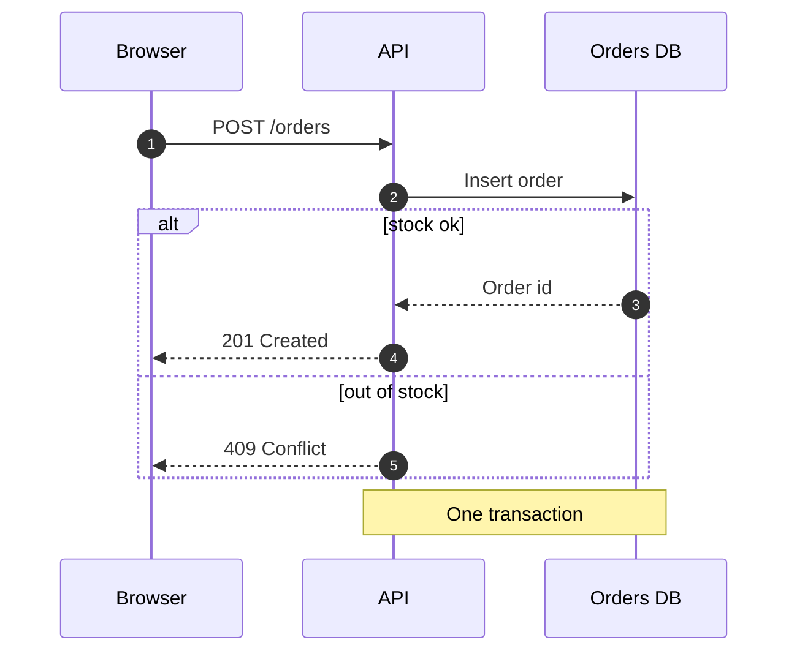
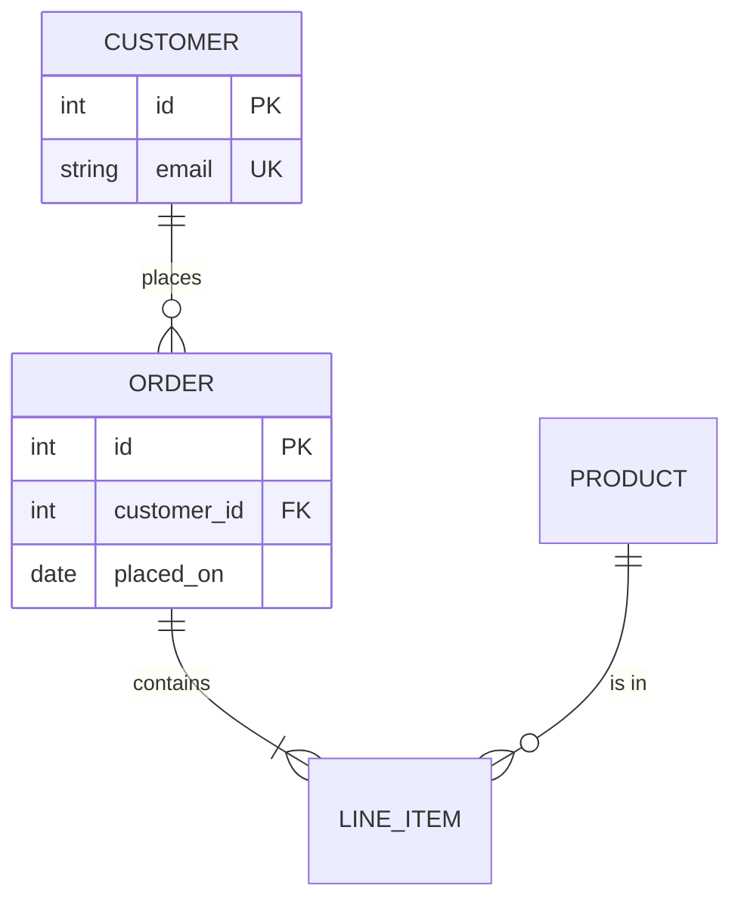
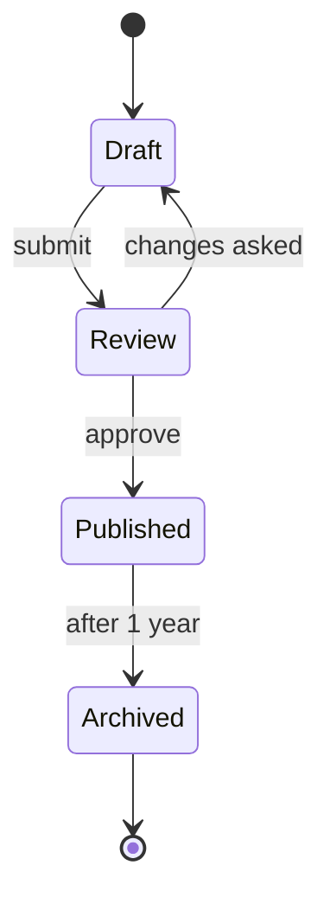
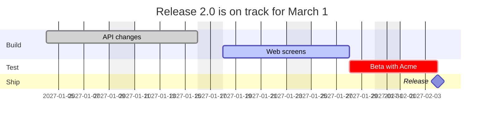
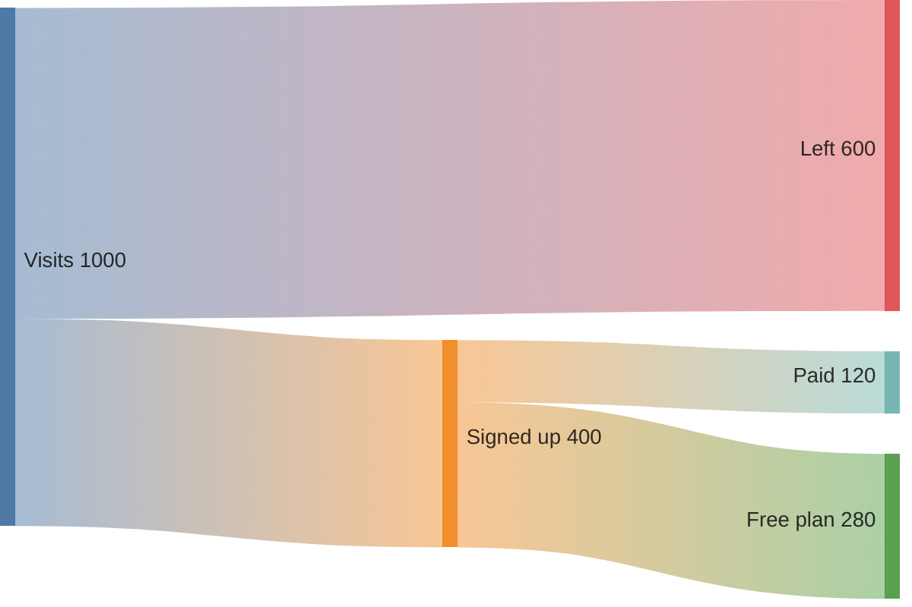

# Mermaid for the Nerve chat

The web chat renders mermaid 12. It themes every diagram type in the table
below, in light and dark. Write no theme, no `%%{init}%%` line and no colours.

## Diagram types and their first line

The first line names the type. A beta type needs the `-beta` word exactly as
shown. "Checked" means the line was rendered with `render.mjs` (mermaid 12.3.0).

| First line | Use for | Checked |
|---|---|---|
| `flowchart TB` / `flowchart LR` (old form: `graph TD`) | steps, decisions, system parts | yes |
| `sequenceDiagram` | messages between parts, in time order | yes |
| `stateDiagram-v2` | states and the events that move between them | yes |
| `erDiagram` | tables, keys, cardinality | yes |
| `classDiagram` | types in code and their relations | yes |
| `gantt` | a plan with dates | yes |
| `timeline` | a few periods with events (grows wide) | yes |
| `journey` | steps of a user task with a score | yes |
| `mindmap` | a hierarchy of ideas | yes |
| `pie` | 2 to 5 parts of a whole (a bar is often better) | yes |
| `quadrantChart` | items on two axes, 2 by 2 | yes |
| `xychart-beta` | a simple bar or line on categories | yes |
| `sankey-beta` | quantities that flow between stages | yes |
| `gitGraph` | branches and merges | yes |
| `C4Context` (also `C4Container`, `C4Component`, `C4Dynamic`, `C4Deployment`) | formal C4 architecture views | yes |
| `block-beta` | blocks in a grid you place by columns | yes |
| `kanban` | columns of cards | yes |
| `treemap-beta` | a hierarchy where size matters | yes |
| `architecture-beta` | services in groups, with built-in icons | yes |
| `packet-beta` | bit or byte layout of a header | yes |
| `requirementDiagram` | requirements and what satisfies them | yes |
| `ishikawa-beta` | causes of a problem (fishbone) | yes |
| `radar-beta` | scores on several axes | yes |
| `treeView-beta`, `venn-beta`, `usecase-beta`, `wardley-beta`, `cynefin-beta`, `railroad-beta`, `swimlane-beta`, `agentflow-beta`, `eventmodeling` | newer types | no: write a small one first and check it |

Prefer `flowchart`, `sequenceDiagram`, `stateDiagram-v2`, `erDiagram` and
`gantt`: people know how to read them. For numbers, prefer vega-lite to `pie`
and `xychart-beta`.

## What the chat does with a diagram

- Draws it after the text stops changing for 600 ms while the reply streams;
  until then it shows the source with "renders when complete".
- A parse error shows the source and one line with the position and the reason.
- A source longer than 200,000 characters stays as source.
- Gantt and `xychart` span the column; other types keep their own size. A wide
  picture scales down while its smallest text stays at least 11 px; else it
  shows at 1:1 with a scroll bar, and a "Fit" / "1:1" button.
- Text floors: 12 px for axis labels, 11 px for all other text. Gantt axis dates
  read "Jan 5" unless the diagram sets its own `axisFormat`.
- Refuses the diagram when it would load from the network: a `url()` in a
  style that does not point to `#fragment`, an image node or an icon from a URL.
  A front matter or `%%{init}%%` block cannot set `themeCSS`, `fontFamily` or
  `securityLevel`.
- `click` callbacks do nothing. A link opens in a new tab.
- `accTitle:` becomes the figure's name; `accDescr:` its description.
- The toolbar offers full size, SVG and PNG downloads, and the source.

## Syntax traps (each one checked)

| Symptom | Cause | Fix |
|---|---|---|
| `got 'end'` | a node id `end` in a flowchart | call it `done` or `End` |
| `got 'PS'` | `(` in a label without quotes: `A[Save (draft)]` | `A["Save (draft)"]` |
| a sequence message stops at `;` | `;` ends a statement | write `#59;` |
| a circle or cross at an arrow end, a node with a cut name | `A---oops`, `A---xray`: `o` and `x` after a link are arrow ends | `A --- oops` (a space) |
| a quote breaks a label | `"` inside `"..."` | write `#quot;` |
| `erDiagram` parse error on a relation line | a relation label with a space or `-` and no quotes: `: one-to-many` | `: "one-to-many"` |

More rules:

- Line break in a label: `A["Line one line two"]`.
- Bold or italic: a markdown string, `` A["`**Done** today`"] ``.
- Comments: `%% text` on a line of its own.
- Arrows: `-->` solid, `-.->` dashed, `==>` thick, `-->|label|` or
  `-- label -->` with a label.
- Groups: `subgraph api [API layer]` ... `end`. A `direction LR` line inside a
  subgraph sets its own direction, but only while no node in it links to a node
  outside it; else the subgraph follows the whole diagram.
- Meaning without colour: `classDef assumed stroke-dasharray: 5 3` and
  `class n1,n2 assumed`.
- Sequence: `participant A as Long name`, `actor U`, `->>` call, `-->>` reply,
  `-x` lost message, `autonumber`, `alt` / `else` / `end`, `opt`, `loop`,
  `par` / `and`, `Note over A,B: text`, `activate A` / `deactivate A`.
- Gantt: `dateFormat YYYY-MM-DD` before the tasks; `id, start, length` or
  `after id`; tags `crit`, `done`, `active`, `milestone` (length `0d`);
  `excludes weekends`.
- ER: `||--o{` (one to zero or more), `||--|{` (one to one or more), `}o--o{`
  (many to many); attributes `type name PK|FK|UK "comment"`; quote an entity
  name with spaces.
- State: `[*]` for start and end, `state "Long name" as S`, a composite
  `state Billing { ... }`, `note right of S : text`.

## Recipes

System parts, with groups and one meaning shown by a dash pattern:

Messages in time order, with a branch:

Data model:

States:

A plan:

A funnel as a flow:

